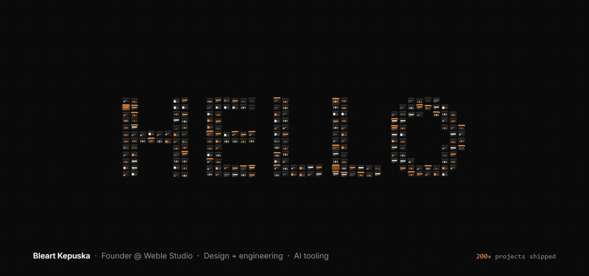

### I'm Bleart

I run [Weble Studio](https://weble.studio) from Prishtina, Kosovo, where I do both the design and the engineering. Over the last five years I've shipped 200+ projects, from client sites to SaaS platforms and internal tools.

Most of my code now goes through AI coding agents, so I build tools for that workflow too. The first ones go open source this month: a WordPress plugin that is itself an MCP server, a security and agents toolkit for Claude Code, and a video player written in Rust.

[weble.studio](https://weble.studio) · [LinkedIn](https://www.linkedin.com/in/bleart-kepuska/)
