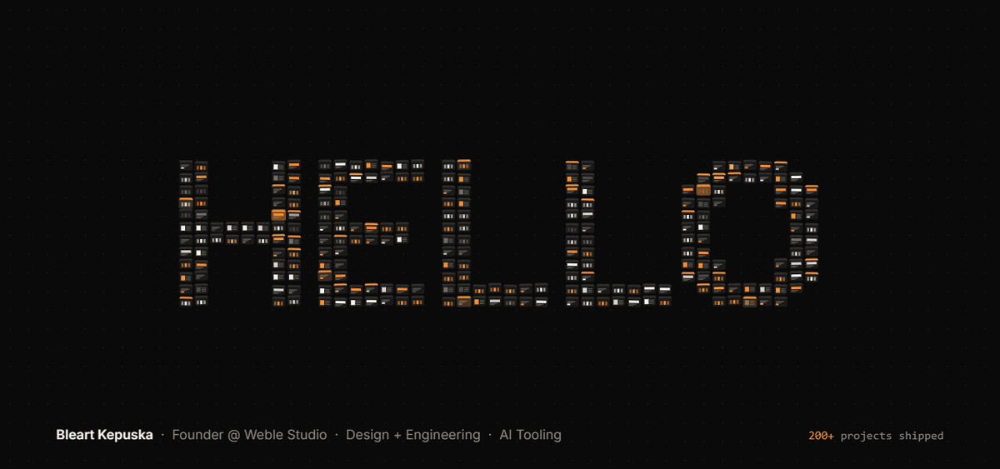

### I'm Bleart

I design and build software, from the first sketch to production. Over the last five years I've shipped 200+ projects, from client sites to SaaS platforms and internal tools. I'm based in Prishtina, Kosovo.

Most of my code now goes through AI coding agents, so I build tools for that workflow too. The first ones go open source this month: a WordPress plugin that is itself an MCP server, a security and agents toolkit for Claude Code, and a video player written in Rust.

[LinkedIn](https://www.linkedin.com/in/bleart-kepuska/) · [Weble Studio](https://weble.studio)
